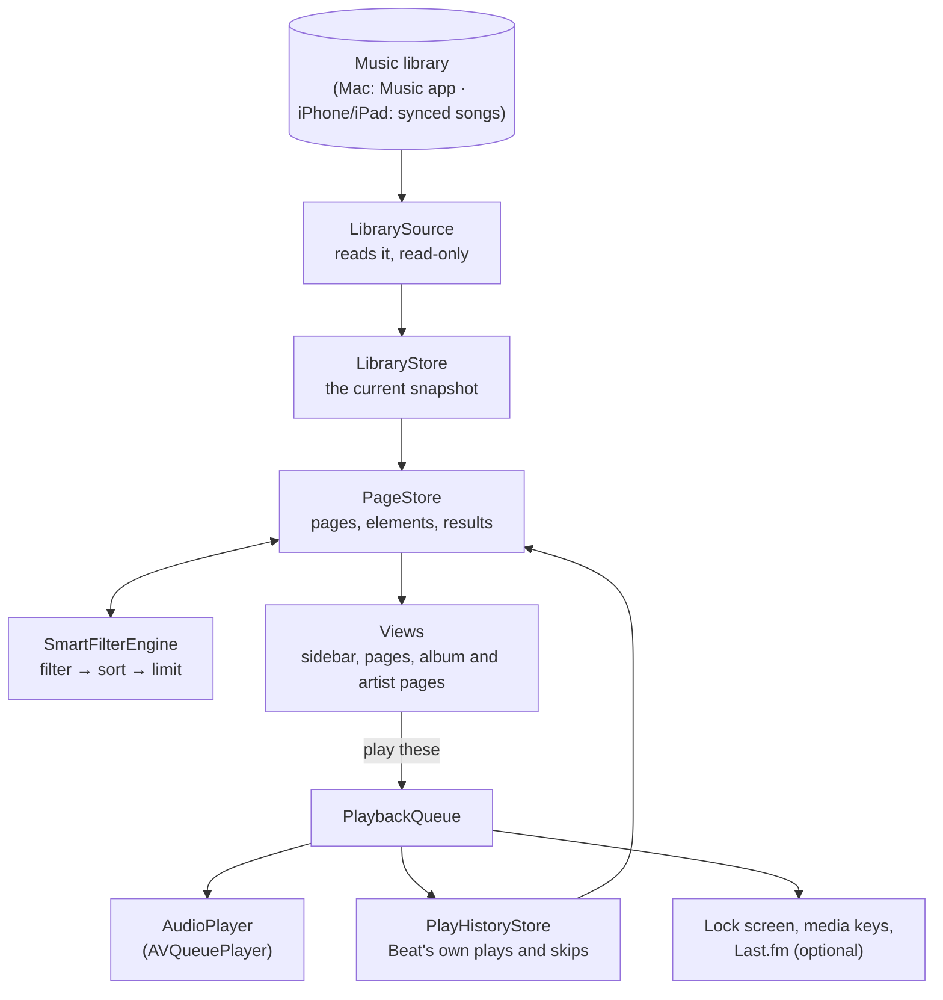
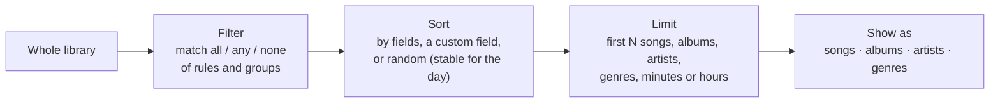
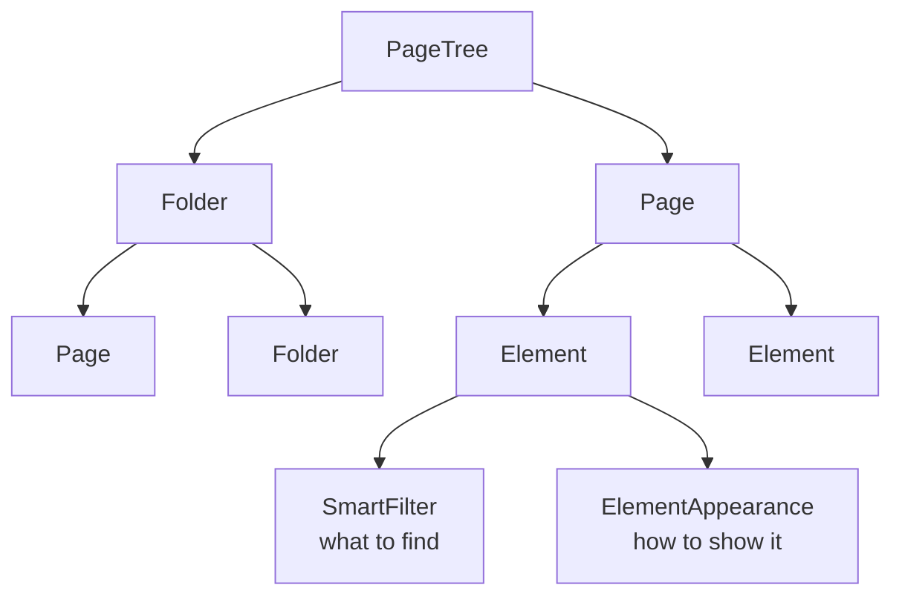
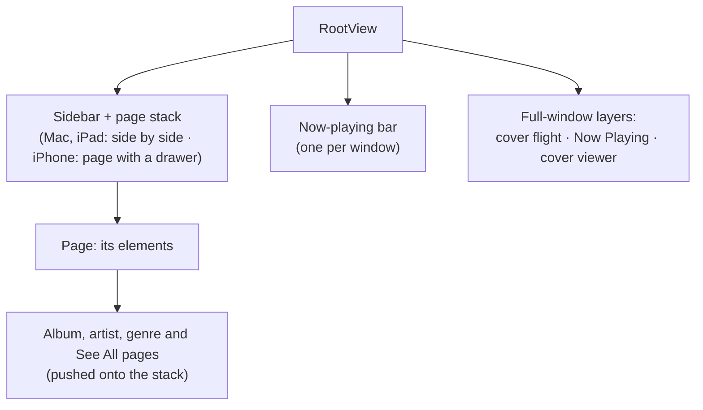
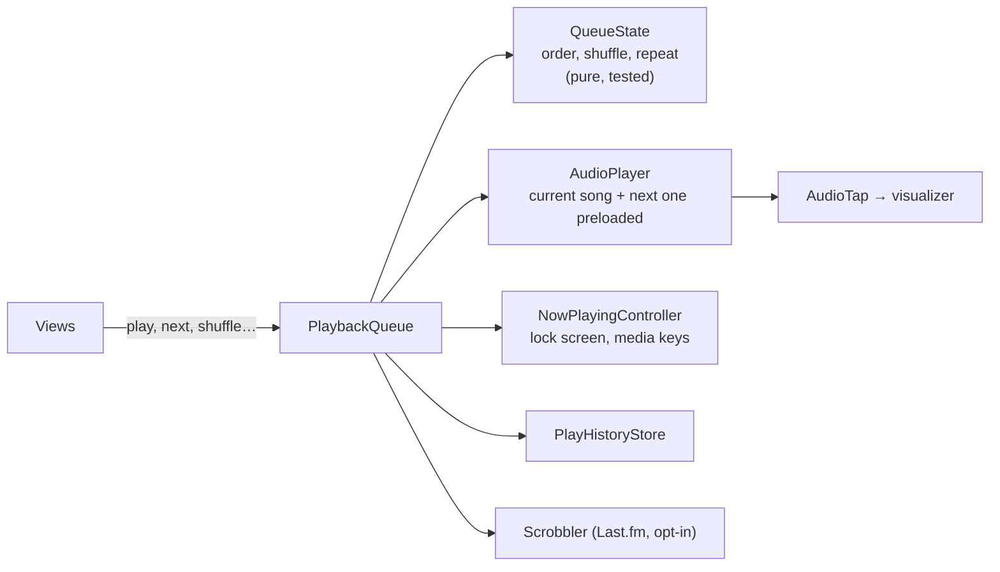
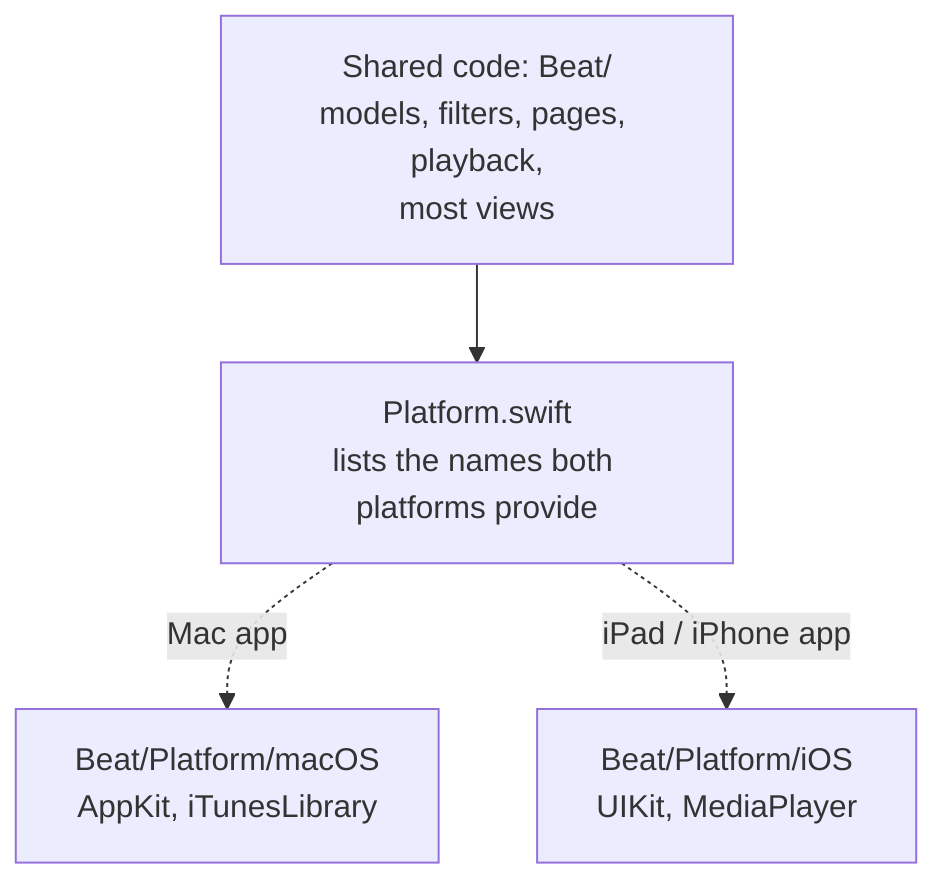

# How Beat is built

Beat is a music player that sits on top of the music you already have. On the Mac it reads the Music app's
library; on iPad and iPhone, the songs synced to the device. It never changes that library. What it adds is its own
way of browsing: a sidebar of **pages**, each made of **elements**, and each element is a **smart filter** (find
songs, sort them, keep some) shown in a layout of your choosing.

This document walks through the pieces in the order data flows through them: from the library, through the
filters, to the screen and the speakers. The diagrams are [Mermaid](https://mermaid.js.org), which GitHub and most
Markdown viewers draw as pictures. For the rules to follow when changing things, see `CLAUDE.md`.

## The big picture

`BeatApp` creates one of each store at launch and hands them to every view through SwiftUI's environment
(`.environment(...)`): `LibraryStore`, `ArtworkCache`, `PlayHistoryStore`, `PlaybackQueue`, `PageStore`,
`AppNavigator` and a few smaller ones (`HeroTransition`, `ArtistImages`, `Scrobbler`). There are no global
singletons beyond the system's own media centres.

Where the code lives:

| Folder | What's in it |
|---|---|
| `Beat/Library` | The data model, reading the library, artwork, the launch caches, play history |
| `Beat/SmartFilters` | What a smart filter is, the engine that runs it, the presets |
| `Beat/Pages` | The sidebar tree of folders and pages, page elements, saving them |
| `Beat/Playback` | The queue, the audio player, the audio tap for the visualizer, system Now Playing |
| `Beat/Lyrics`, `Beat/ArtistInfo`, `Beat/Scrobbling` | The optional online extras: LRCLIB lyrics, Discogs artist info, Last.fm |
| `Beat/DesignSystem` | Liquid Glass (with a fallback for macOS 15), artwork views, blurred backdrops |
| `Beat/Views` | The screens |
| `Beat/Platform` | Everything that differs between the Mac and iPad/iPhone (see [Platforms](#platforms)) |
| `BeatTests` | Unit tests for the pure logic |

## The library

Everything starts with a **`LibrarySnapshot`**: an immutable value holding every playable song (`Track`) and the
albums, artists and genres built from them (`LibrarySnapshot.build(tracks:)`, a pure, tested function). Because
it's a plain value, it can be handed to background work freely.

A **`LibrarySource`** produces it. There are three, one per situation:

| Source | Where | Reads |
|---|---|---|
| `LibraryLoader` | Mac | The Music app's library through `iTunesLibrary.framework` |
| `MediaLibrarySource` | iPhone, iPad | Songs synced from a Mac, through MediaPlayer (`MPMediaQuery`) |
| `FolderLibrarySource` | Simulator | Audio files saved to the app's Music folder, since the Simulator has no library |

Songs without a playable file (Apple Music streaming, cloud-only, DRM) are skipped. Beat only plays local files.

**`LibraryStore`** owns the current snapshot. Reading 20,000 songs takes a few seconds, so launch is two-stage:

1. Show the library saved last time (`LibraryCache`, a JSON file in Caches) straight away.
2. Read the real library behind it, and swap it in only if something changed.

Cover thumbnails are saved too (`ArtworkDiskCache`, small HEIC files), named after the cover they came from, so a
changed cover never shows a stale picture. `ArtworkCache` decodes and scales artwork off the main thread, keeps
each cover's colour palette (`ArtworkPalette`), and serves anything already loaded instantly.

The library is re-read when Music changes it: the Mac watches Music's database files (`LibraryWatcher`, FSEvents),
iOS listens for MediaPlayer's change notification. Switching back to Beat re-reads only if something changed.

**`PlayHistoryStore`** keeps Beat's own play and skip counts (a play counts at half the song or 4 minutes). They
are merged with Music's counts when filters run, and never written back to Music.

## Smart filters

A smart filter is a short pipeline of steps, run in order:

Steps can repeat and their order matters: "sort by plays, keep 25" isn't "keep 25, sort by plays". A filter that
shows albums still works on songs underneath; the albums are whatever those songs belong to.

The model is in `SmartFilter.swift` and `Field.swift`. The engine (`SmartFilterEngine.evaluate`) is a pure function
from a filter and a **`PreparedLibrary`** (the snapshot with play history merged in, plus the current date) to a
`FilterResult`. Being pure makes it easy to test and safe to run in the background:

- Each filter step is compiled once into a closure rather than interpreted per song.
- Text fields are folded (case and accents removed) once per library, not once per comparison.
- A page's elements are evaluated in parallel.

**Custom fields** (`CustomField.swift`) let you sort by something inside a tag, like a catalogue number in
brackets, or anything a regular expression can pull out.

## Pages

The sidebar is a free-form tree: folders and pages, mixed at any level. Only pages hold content.

Each **element** owns its filter and its appearance: shelf, grid, list, Cover Flow or year timeline, plus size,
rows, spacing and so on. Home is just an ordinary page.

**`PageTree`** (pure, tested) does every structural change: insert, move, duplicate, delete. **`PageStore`** holds
the tree, saves it to `pages.json`, and runs filters lazily, only for the page on screen and only for elements that
changed. A `pages.json` that won't read is set aside rather than overwritten.

The **element editor** (`FilterEditorSheet`) edits a draft (`EditableFilter`, a copy of the filter with an ID on every
piece so lists can be edited safely) and shows a live preview built from the real element view. Its layout differs
by platform: a window with the preview beside Rules and Appearance on the Mac, and forms in a navigation stack on
iPad and iPhone (see [Platforms](#platforms)).

## On screen

`RootView` lays out the window: the sidebar, the page with its navigation stack, and a few full-window layers on top.

A few things are worth knowing about why it's shaped this way:

- **The now-playing bar and the full-window layers sit above the navigation stack, not inside it.** Pages pushed
  onto a stack are drawn above anything attached to the stack, so the bar would vanish under an album page. One bar
  for the whole window also stays still while pages slide in and out.
- **Opening an album or artist is always done through `AppNavigator`** (`openAlbum`, `openArtist`, `openGenre`).
  It keeps one navigation trail per sidebar page, returns to a page already in the trail instead of opening it
  twice, and remembers each page's scroll position and search.
- **Album and artist pages take their colours from the cover.** `CoverTint` works out the front page's palette and
  everything that follows the cover reads from it: the page, the sidebar, the now-playing bar and, on the Mac, the
  window's light or dark. Text colours are picked to stay readable on the cover's background.
- **Covers fly between screens.** On the Mac, tapping a tile flies its cover into the album page's header and back
  again (`HeroTransition`). Views in separate columns can't share SwiftUI's matched geometry, so each tile carries a
  tiny probe that reports its position in the window (`FrameProbe`), and the flight is drawn in a layer over
  everything. iPad and iPhone use iOS's own zoom transition instead, which can follow a swipe down.
- **Library ▸ Songs** groups every song by album under its album artist. On the Mac that's an AppKit table, since a
  SwiftUI list of ~3,000 album blocks was too slow; on iPad and iPhone, for now, a SwiftUI list.
- **Grids, shelves and lists work from the keyboard** on the Mac (`KeyboardGrid`): each collection is one Tab stop,
  and the arrow keys move a highlight across it.

### Now Playing

The bar opens **Now Playing**, which grows out of the bar to fill the window and shrinks back into it. It shows the
cover on its own colours, the transport, optional **lyrics** and a full-screen **visualizer**:

- **Lyrics** come from, in order: a `.lrc` file beside the song, lyrics embedded in the file, then (only if you turn
  it on) LRCLIB online. Synced lyrics follow the song and seek when tapped. A DJ mix whose "lyrics" are a timed
  tracklist becomes **chapters** instead: the progress line splits at each track (`MixChapters`).
- **The visualizer** reads the audio through a tap on the player (`AudioTap`), analyses it on the main thread
  (`SpectrumAnalyzer`, an FFT into 64 bands) and draws it as a waveform or one of several scenes. Radial, a ring of
  bars around the cover, is toggled by clicking the cover.

## Playback

`PlaybackQueue` is what the views talk to. The ordering rules (shuffle that keeps the current song first, repeat
one and all, skipping missing files) live in `QueueState`, a pure struct with its own tests. `AudioPlayer` keeps the
current song plus the next one loaded, so songs follow each other with almost no gap. On the Mac the volume slider
is Beat's own; on iPad and iPhone it is the system volume.

## Platforms

Beat is two apps from one set of sources. The Mac target (`Beat`) and the iPad/iPhone target (`BeatiOS`) compile
the same `Beat/` folder, except that each leaves out the other's half of `Beat/Platform/`.

Shared code never mentions AppKit or UIKit. Where the platforms differ, both folders provide the **same names**,
and each app compiles one of them:

| File (in both folders) | What it provides |
|---|---|
| `Platform+*.swift` | Images and colours (`PlatformImage`, `PlatformColor`), opening links, the window background, small view helpers |
| `Window+*.swift` | The window around `RootView`: light/dark handling and event monitors on the Mac; phone layouts, the sidebar drawer, Settings as a sheet and zoom transitions on iOS |
| `BeatApp+*.swift` | Start-up setup, menus, the Mac's Settings window and About panel |
| `SettingsView+*.swift` | The Settings container (Mac tabs, iOS list) and settings-file import/export |
| `ElementEditor+*.swift` | The element editor's layout |
| `FrameProbe.swift` | The tiny view that reports a tile's position for transitions |
| `BarLayers.swift` | The now-playing bar's progress drawing |
| `AlbumSongsTable.swift` | Library ▸ Songs |
| `LibraryWatcher.swift`, `OutputRoute.swift`, `RoutePicker.swift`, `VolumeControl.swift` | Library changes, AirPlay, volume |

Some pieces exist on one platform only: the library loaders (above), the Mac's keyboard and trackpad monitors
(Space to play, ⌘[ and swipe back), and the iOS sidebar drawer, form-based rule editor, back-swipe restorer and
keyboard dismissal. Differences of a line or two stay in the shared file as `#if os(macOS)`.

**Phones and narrow iPad windows** get their own layouts through one switch, `\.compactLayout` (set from iOS's
horizontal size class, always off on the Mac):

- The sidebar becomes a drawer over the page.
- Album and artist headers stack, lists drop their cards, and shelves size their covers to the screen.
- The element editor becomes forms with Cancel and Save in its navigation bar.
- Now Playing stacks the cover, lyrics and controls vertically.

Because the switch is off on the Mac, the Mac's layouts never change.

## What's saved where

| What | Where | Owner |
|---|---|---|
| Pages, elements and custom fields | `Application Support/Beat/pages.json` | `PageStore` |
| Beat's plays and skips | `Application Support/Beat/history.json` | `PlayHistoryStore` |
| Scrobbles waiting to send | `Application Support/Beat/scrobbles.json` | `Scrobbler` |
| Downloaded lyrics | `Application Support/Beat/lyrics/` | `LyricsProvider` |
| Downloaded artist info and photos | `Application Support/Beat/artists/` | `ArtistInfoProvider` |
| The library as last read, for a fast launch | `Caches/Beat/library.json` | `LibraryCache` |
| Cover thumbnails | `Caches/Beat/Thumbnails/` | `ArtworkDiskCache` |
| Last.fm session, Discogs token | Keychain | `Scrobbler`, Settings |
| Preferences, the selected page, open folders, volume | `UserDefaults` | Settings, `AppNavigator`, `PlaybackQueue` |

Settings ▸ General ▸ Export saves pages, elements, custom fields and the preferences in one file
(`SettingsArchive`), which is how they move between a Mac and an iPhone. Tokens and play history stay on each device.

## Doing work off the main thread

The stores, the player and the views run on the main actor. The library, filters and results are plain `Sendable`
values, so the heavy work (reading the library, running filters, decoding artwork) happens in background tasks and
only the result comes back. The library loaders are actors. The one exception to "analysis on the main thread" is
the audio tap's callback, which runs on the real-time audio thread and therefore only copies samples into a buffer:
no allocation, no locks it can wait on.
