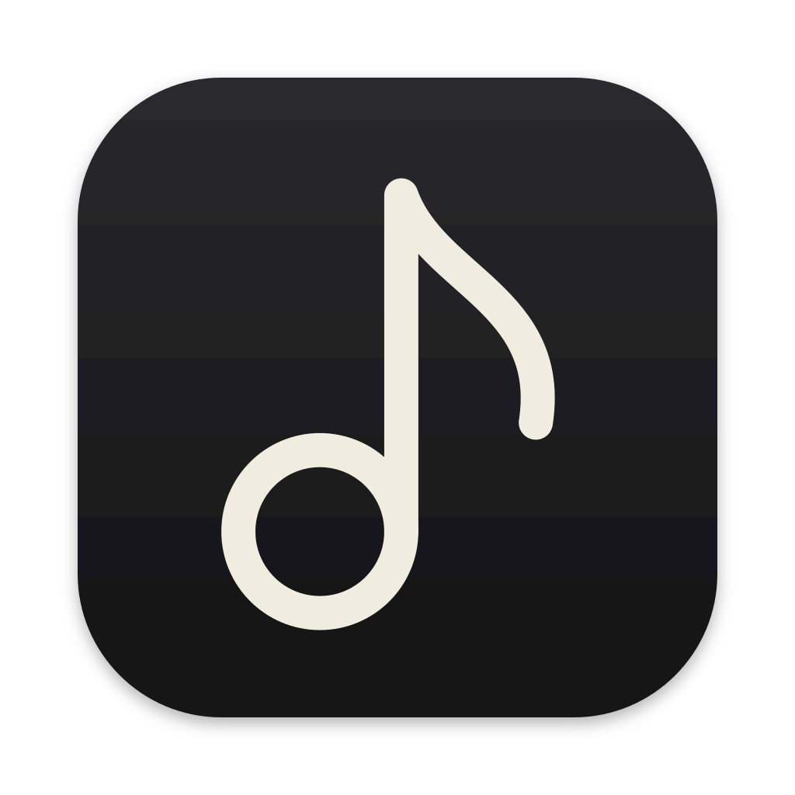

# Beat

A music player for Mac, iPhone and iPad, for the music you already have: the Music app's library on the Mac, and the
songs synced to your device on iPhone and iPad.

Apple's Music app is great for tagging, but listening on the desktop felt clunky. I needed a way to browse record
labels' discographies, and there was no easy way short of making a playlist for each label. So I built Beat.

<p align="center"></p>

See it, and try a live demo, at [beat.gouthaman.dev](https://beat.gouthaman.dev).

## Features

- **Pages and folders.** A free-form sidebar of folders and pages, in any order. Each page holds elements, and each
  element is a smart filter with its own look: shelf, grid, list, Cover Flow or timeline.
- **Smart filters.** Steps that run in order (filter, sort, limit) over albums, songs, artists or genres. Rules use any
  track field, including Beat's own play and skip counts, in groups that match all, any or none and nest inside each
  other, with a live preview while you edit.
- **Custom fields.** Pull a value out of a tag you already have, such as a catalog number in brackets after the album
  title, and sort by it.
- **Library browsing.** Albums, Artists, Genres and Songs, with cover-coloured album and artist pages and a zoom from
  cover to page.
- **Quick Open.** Find any page, album, artist, genre or song from anywhere: ⌘K on the Mac, the search button in the
  sidebar on iPad and iPhone.
- **Playback.** Gapless, with a queue, shuffle and repeat, media keys, Now Playing in Control Centre, and AirPlay.
- **Now Playing.** Coloured by the album's cover (or not, if you turn it off), with synced lyrics and eight
  visualizers.
- **Lyrics.** `.lrc` files beside the song, lyrics saved in the file, and optional lookups on
  [LRCLIB](https://lrclib.net). A DJ mix with a timestamped tracklist gets each track marked on the progress bar.
- **Artist info.** Optional bios and photos from [Discogs](https://www.discogs.com), using your own Discogs token.
- **Last.fm scrobbling.** Optional: shows what's playing on your profile and scrobbles what you play, including plays
  made offline.
- **Library Health** (Mac). Finds duplicates, missing tags and artwork, missing files and albums split in two, and
  shows you each one to fix in Music.
- **Settings export.** Your pages and preferences in one file, to back up or move to another device.
- **Liquid Glass** on macOS and iOS 26, with frosted materials on macOS 15.

## Privacy

- **Your Music library is read-only.** On the Mac, Beat reads it through Apple's `iTunesLibrary` framework and never
  writes to it. Play counts and skips are kept in Beat's own file (`~/Library/Application Support/Beat`).
- **No network by default.** Lyrics, artist info and Last.fm scrobbling are off until you turn them on in Settings.
  With them off, Beat makes no network requests. There's no analytics or data collection of any kind.
- **Local, DRM-free files only.** Apple Music streaming and cloud-only tracks are skipped.

## Requirements

- **Mac:** macOS 15 or later, and a Music library with local, DRM-free files.
- **iPhone and iPad:** iOS or iPadOS 26, with songs synced from a Mac (in Finder).
- **To build:** a Mac with Xcode 26 (Swift 6.2) and [XcodeGen](https://github.com/yonaskolb/XcodeGen)
  (`brew install xcodegen`).

## Installing

**Mac:** download `Beat.dmg` from the [latest release](https://github.com/gouthamank/Beat/releases/latest), open it
and drag Beat to Applications. Beat isn't notarised by Apple, so the first time you open it macOS says it can't check
it: choose **Done**, then **System Settings ▸ Privacy & Security ▸ Open Anyway**.

**iPhone and iPad:** Beat isn't on the App Store. Build it yourself, as below.

## Building

The Xcode project is generated from `project.yml` by XcodeGen and isn't checked in; the `make` targets generate it for
you. To work in Xcode instead, run `xcodegen generate` and open `Beat.xcodeproj`.

### Setup

Every build needs a bundle ID prefix of your own. Copy `Config/Secrets.xcconfig.example` to `Config/Secrets.xcconfig`
(git-ignored) and set `BEAT_BUNDLE_PREFIX`, such as `com.yourname` for `com.yourname.Beat`. `make` stops and says so
if it's missing.

### On iPhone and iPad

You need an Apple ID (free works too) signed in to Xcode (**Xcode ▸ Settings ▸ Accounts**).

1. In `Config/Secrets.xcconfig`, set `DEVELOPMENT_TEAM` to your team ID. In **Xcode ▸ Settings ▸ Accounts**, select
   your Apple ID.
2. Connect the iPhone or iPad by cable, unlock it and tap **Trust** for this Mac.
3. On the device, turn on **Settings ▸ Privacy & Security ▸ Developer Mode** and let it restart.
4. Run `make install on=ios`. It builds for that device and installs Beat on it.
5. The first time, the device won't open an app from an unknown developer: in **Settings ▸ General ▸ VPN & Device
   Management**, trust your Apple ID. Then open Beat and allow access to **Apple Music**.

With a free Apple ID, the installed build stops opening after 7 days: run `make install on=ios` again to renew it. Your
pages and settings stay. A free account can also only have 3 apps of its own on a device at once. A paid developer
account lifts both limits (builds last a year).

No device? `make sim on=iphone` (or `on=ipad`) runs Beat in the Simulator with just the setup above: no team ID or
device steps. The Simulator has no music library: drag audio files onto it and save them to **Files ▸ On My iPhone ▸
Beat ▸ Music**.

### On the Mac

Beat is signed with a self-signed certificate named **Beat Local Signing**, so macOS keeps its Music and Keychain
permissions across rebuilds. Create one once:

1. In Keychain Access, choose **Certificate Assistant ▸ Create a Certificate…**
2. Name it `Beat Local Signing`, with Identity Type **Self Signed Root** and Certificate Type **Code Signing**.
3. Open the new certificate and set **Trust ▸ Code Signing** to **Always Trust**.

Or use a certificate you already have by changing `CODE_SIGN_IDENTITY` in `project.yml`.

Then `make install on=mac` builds a Release, copies it to `/Applications` and opens it. On first launch, allow access
to **Media & Apple Music**.

### Last.fm (optional)

Scrobbling needs a Last.fm API account of your own. It's kept out of the repository:

1. Create an API account at [last.fm/api/account/create](https://www.last.fm/api/account/create).
2. In `Config/Secrets.xcconfig` (see Setup), fill in the API key and shared secret.
3. Build, then turn it on in **Settings ▸ Last.fm** and click **Connect**.

Without a key (or with the example's placeholder values) Beat builds and runs normally, with scrobbling off and no
Last.fm tab in Settings.

### Make targets

```sh
make                   # lists every target
make install           # menu: Mac (Release, copied to /Applications and launched) or a connected iPad/iPhone
make sim               # menu: run in the iPad or iPhone Simulator
make test              # menu: Mac tests, iOS Simulator tests, Mac UI tests, or all
make snapshot-record   # menu: re-record the snapshots or screenshots a design change altered
make clean             # delete build/
```

Each menu also takes its choice up front, e.g. `make install on=mac`, and the targets they lead to run directly too
(`make mac-install`, `make ios-test`, …): see `TESTING.md` for the tests.

## Project layout

| Folder | What's in it |
| --- | --- |
| `Beat/Library` | Reading the library, artwork, play history, Library Health |
| `Beat/SmartFilters`, `Beat/Pages` | Smart-filter engine, the page tree, settings export |
| `Beat/Playback` | Queue, audio, Now Playing, AirPlay, visualizer analysis |
| `Beat/Lyrics`, `Beat/ArtistInfo` | Lyrics and Discogs artist info |
| `Beat/Scrobbling` | Last.fm sign-in, requests and the scrobble queue |
| `Beat/Views` | SwiftUI views shared by every device |
| `Beat/Platform` | What differs between the Mac (`macOS/`) and iPad and iPhone (`iOS/`) |
| `Beat/DesignSystem` | Glass, artwork, backdrops, shadows |
| `BeatTests` | Unit tests |
| `BeatUITests`, `BeatiOSUITests` | UI tests on the Mac and in the iOS Simulator |
| `Fixtures` | A small tagged library the tests and UI tests run on |
| `Design/AppIcon` | App icon source and renderer |
| `Design/Showcase` | A made-up library with generated covers, for the website and its screenshots |
| `site` | The website, [beat.gouthaman.dev](https://beat.gouthaman.dev): Astro, built by Netlify (`netlify.toml`); `cd site && npm install && npm run dev` to work on it |
| `Config` | Build settings; your bundle ID prefix, team ID and Last.fm keys go in `Secrets.xcconfig` |
| `Scripts` | Helpers for `make`'s menus and saving UI test screenshots |

See [ARCHITECTURE.md](ARCHITECTURE.md) for how the pieces fit together, [TESTING.md](TESTING.md) for the tests and
[RELEASING.md](RELEASING.md) for publishing a release.

## License

[MIT](LICENSE) © 2026 Gouthaman Kumar
