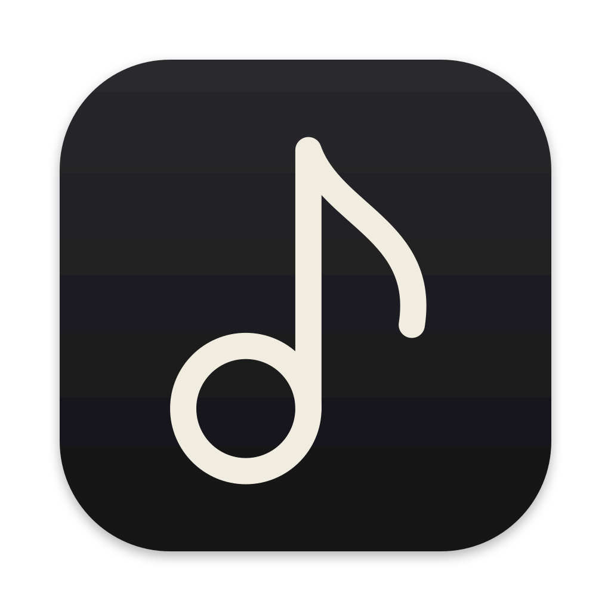

# Beat

A native macOS music player for the library you already keep in the Music app. Beat reads that library (never changing it), plays your local files itself, and organises them into a sidebar of folders and pages built from smart filters.

<p align="center"></p>

## Features

- **Pages and folders.** A free-form sidebar of folders and pages. Each page holds elements, and each element is a smart filter (Filter → Sort → Limit) with its own look: grid, shelf or list, with columns you choose.
- **Smart filters.** Rules on any track field, including Beat's own play and skip counts, with a live preview while you edit.
- **Library browsing.** Albums, Artists, Genres and Songs, with cover-coloured album and artist pages and a zoom from cover to page.
- **Playback.** Plays local files with a queue, shuffle and repeat, media keys, Now Playing in Control Centre, and AirPlay.
- **Now Playing.** Full-window view with synced lyrics and a visualizer.
- **Lyrics.** Embedded lyrics, `.lrc` files beside the track, and optional lookups on [LRCLIB](https://lrclib.net). Timestamped tracklists in DJ mixes work too.
- **Artist info.** Optional bios and photos from [Discogs](https://www.discogs.com), using your own Discogs token.
- **Last.fm scrobbling.** Optional: shows what's playing on your profile and scrobbles every song you play past halfway, including plays made offline.
- **Liquid Glass** on macOS 26, with frosted materials on macOS 15.

## Privacy

- **Your Music library is read-only.** Beat reads it through Apple's `iTunesLibrary` framework and never writes to it. Play counts and skips are kept in Beat's own file (`~/Library/Application Support/Beat`).
- **No network by default.** Lyrics, artist lookups and Last.fm scrobbling are off until you turn them on in Settings. With them off, Beat makes no network requests.
- **Local, DRM-free files only.** Apple Music streaming and cloud-only tracks are skipped.

## Requirements

- macOS 15 or later
- A Music library with local, DRM-free files
- To build: Xcode 26 (Swift 6.2) and [XcodeGen](https://github.com/yonaskolb/XcodeGen) (`brew install xcodegen`)

## Building

The Xcode project is generated from `project.yml` and isn't checked in.

### Signing

Beat is signed with a self-signed certificate named **Beat Local Signing**, so macOS keeps its Music and Keychain permissions across rebuilds. Create one once:

1. In Keychain Access, choose **Certificate Assistant ▸ Create a Certificate…**
2. Name it `Beat Local Signing`, with Identity Type **Self Signed Root** and Certificate Type **Code Signing**.
3. Open the new certificate and set **Trust ▸ Code Signing** to **Always Trust**.

Or use a certificate you already have by changing `CODE_SIGN_IDENTITY` in `project.yml`.

### Last.fm (optional)

Scrobbling needs a Last.fm API account of your own. It's kept out of the repository:

1. Create an API account at [last.fm/api/account/create](https://www.last.fm/api/account/create).
2. Copy `Config/Secrets.xcconfig.example` to `Config/Secrets.xcconfig` (git-ignored) and fill in the API key and shared secret.
3. Build, then turn it on in **Settings ▸ Last.fm** and click **Connect**.

Without a key (or with the example's placeholder values) Beat builds and runs normally, with scrobbling off and no Last.fm tab in Settings.

### Build and install

```sh
make                   # lists every target
make install           # menu: Mac (Release, copied to /Applications and launched) or a connected iPad/iPhone
make sim               # menu: run in the iPad or iPhone Simulator
make test              # menu: Mac tests, iOS Simulator tests, Mac UI tests, or all
make snapshot-record   # menu: re-record the snapshots or screenshots a design change altered
make clean             # delete build/
```

Each menu also takes its choice up front, e.g. `make install on=mac`, and the targets they lead to run directly too
(`make mac-install`, `make ios-test`, …): see `TESTING.md` for the tests.

To work in Xcode instead, run `xcodegen generate` and open `Beat.xcodeproj`.

On first launch, allow access to **Media & Apple Music**.

## Project layout

| Folder | What's in it |
| --- | --- |
| `Beat/Library` | Reading the Music library, artwork, play history |
| `Beat/SmartFilters`, `Beat/Pages` | Smart-filter engine, the page tree, settings export |
| `Beat/Playback` | Queue, audio, Now Playing, AirPlay, visualizer analysis |
| `Beat/Lyrics`, `Beat/ArtistInfo` | Lyrics and Discogs artist info |
| `Beat/Scrobbling` | Last.fm sign-in, requests and the scrobble queue |
| `Beat/Views` | SwiftUI views |
| `Beat/DesignSystem` | Glass, artwork, backdrops, shadows |
| `BeatTests` | Unit tests |
| `Design/AppIcon` | App icon source and renderer |
| `Config` | Build settings; your Last.fm keys go in `Secrets.xcconfig` |

See [ARCHITECTURE.md](ARCHITECTURE.md) for how the pieces fit together.

## License

[MIT](LICENSE) © 2026 Gouthaman Kumar
